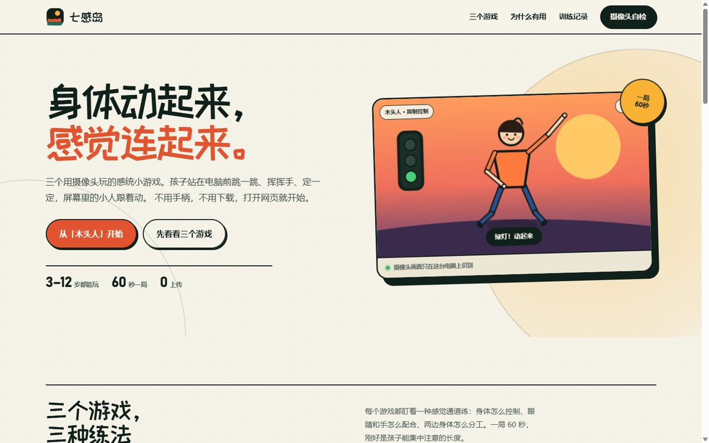
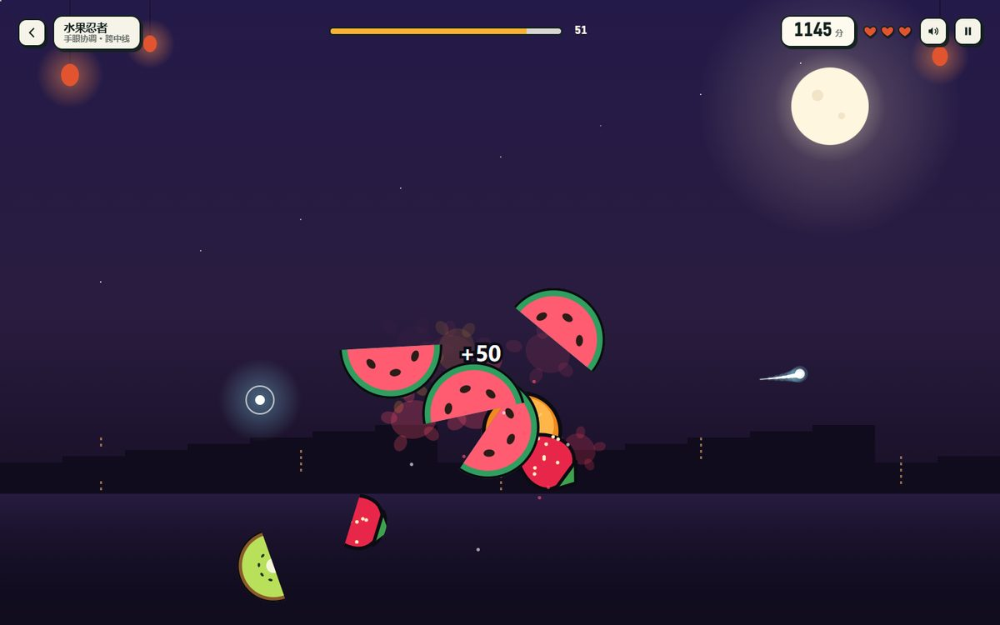

# 动感岛 · 用身体玩的感统小游戏

六个用摄像头玩的儿童体感小游戏，打开网页就能玩：不用手柄，不用下载，画面只在本机识别。



| 游戏 | 感觉通道 | 练什么 | 怎么玩 |
| --- | --- | --- | --- |
| **打地鼠** 🆕 | 视觉—动作 | 反应速度、跨中线、抑制控制 | 地洞围着孩子摆一圈，地鼠冒头就伸手拍；金地鼠三倍分，皱眉的刺猬要忍住不拍 |
| **木头人** | 本体觉 | 抑制控制、听觉指令、全身爆发力 | 绿灯使劲动攒金币，听到「木头人」马上定住；整段定住有奖励，动一下少一颗心 |
| **墙来了** 🆕 | 本体觉 | 动作模仿、动作计划、双侧协调 | 挖了人形洞的墙飞过来，墙到面前前摆出同样的姿势就能穿墙而过；后面会有「蹲下来」 |
| **水果忍者** | 视觉—动作 | 手眼协调、视觉追踪、跨中线 | 挥手臂切飞起来的水果，连击越高分越多，别碰炸弹；最后 10 秒下水果雨 |
| **跳大绳** 🆕 | 前庭觉 | 节奏感、视觉预判、下肢爆发力 | 两个小伙伴在两边摇绳，绳子甩到脚下时起跳，连跳 4 个就加速，绊到会自动放慢 |
| **节奏跳跳** | 前庭觉 | 双侧协调、节奏感 | 踩鼓点向左、向右、原地起跳，光圈收拢时正好到位就是「完美」 |

每局 60 秒，按分数拿 1～3 颗星；游戏里顶部的星星条会实时涨，拿到一颗星就有语音和动画提示。难度跟着孩子的表现自动调（地鼠缩回去的速度、墙飞来的速度、绳子的速度、水果的密度），不用家长手动选。

| 站位 | 游戏里 |
| --- | --- |
|  |  |

## 怎么打开

1. 双击 **`start.bat`**（会启动本地服务器并打开浏览器）。
2. 首页点「今日挑战」或任意一个游戏，再点「打开摄像头，开始」，允许浏览器使用摄像头。
3. **站到位**：这一屏不弹窗，直接把摄像头画面给你看。站进取景框、被识别到之后头顶会出现一圈进度环，**站稳 1.6 秒自动开始**（也可以点「开始游戏」或按回车）。只要头和手在画面里就能玩，不用退到房间另一头。
4. 一局结束后，点「再来一局」或下方「接着玩」里的另一个游戏，**摄像头和动作识别不用重新加载**，人还在画面里就直接倒计时。

站在离电脑 **1～2 米** 的地方就够了（笔记本放桌上、屏幕稍微往上翻一点）。如果不知道往哪边挪，状态栏会直接说：「往中间一点」「后退半步」「光线有点暗」。

如果这台电脑没有摄像头，点「没有摄像头？用鼠标试玩」：移动鼠标＝挥手（左手自动镜像），`空格`＝起跳，`S`＝下蹲，`A`/`D`＝左右移动，按住 `Shift` 只动右手。

> 为什么不能直接双击 `index.html`：浏览器只允许 `http://` 或 `https://` 页面调用摄像头，`file://` 不行。

换端口：`set PORT=4322 && node server.mjs`

## 页面

- `index.html` —— 首页：今日挑战、六个游戏、三种感觉、成长记录（本周打卡、每个游戏的最好成绩、最近玩过）
- `play.html?game=mole|freeze|wall|fruit|rope|hop` —— 统一游戏容器（加 `&mode=mouse` 直接进鼠标模式）
- `check.html` —— 摄像头自检（30 秒，检查头手是否入镜、光线、站位）

## 技术说明

- **姿态识别**：[MediaPipe Pose Landmarker](https://ai.google.dev/edge/mediapipe/solutions/vision/pose_landmarker)（`@mediapipe/tasks-vision`）本地运行，模型和 wasm 都放在 `vendor/`，**完全离线**，不需要联网、不上传任何画面。
- **模型**：默认 `pose_landmarker_lite`（快，够用）；地址加 `?q=full` 换 `pose_landmarker_full`（更准，更吃显卡）。
- **坐标**：摄像头画面按 `cover` 方式铺满画布并水平镜像，关键点用同一套变换映射到屏幕坐标，孩子抬左手，屏幕里的小人也在左边抬左手（旧版画面没镜像、小人镜像了，两者左右对不上，已修正）。
- **起跳检测**：`JumpDetector`（`js/kit.js`）只看肩膀中点相对“站立基线”的升高量（按肩宽归一化），所以只露上半身也能判断跳没跳；跳大绳用它判定绳子到脚下时人在不在空中。
- **姿势匹配**：墙来了把上臂、前臂的朝向和目标姿势逐段比角度（±18° 内满分，超过 60° 记零），蹲下用肩膀相对站立高度的下降量判断。
- **运动量**：取手腕、手肘、肩、髋、膝、踝、鼻子的逐帧位移，按「肩宽/秒」归一化后做指数平滑，得到 0～1 的运动量。木头人用它判断「动没动」，跳跃用它判断「离地没离地」。
- **小人渲染**：`js/avatar.js` 把 13 个关键点画成剪纸风角色（先粗描边再填色、圆头、呆毛、腮红），所以任何背景下都能看清轮廓。

## 文件结构

```
index.html / play.html / check.html
css/            base 设计变量、首页、游戏页、自检页、标题字
js/
  pose.js       摄像头 + MediaPipe + 平滑/运动量 + 鼠标小人
  avatar.js     骨骼 → 纸片小人（含开合跳动画姿势）
  kit.js        数学、粒子、音效、程序化音乐、语音、描边大字、起跳检测
  runtime.js    游戏运行时（站位自动开始、HUD 星星条、倒计时、暂停、结算、换游戏）
  play.js       感统游戏入口
  poses.js      姿势匹配打分、人形剪影、挖洞的墙（墙来了用）
  store.js      本机记录：每局成绩、每个游戏最好成绩、连续打卡
  home.js       首页渲染（今日挑战、动画舞台、游戏卡、成长记录）
  check.js      自检页
  games/        mole.js  freeze.js  wall.js  fruit.js  rope.js  hop.js  index.js
vendor/         mediapipe 运行时 + 姿态模型（离线）
assets/fonts/   标题字子集（站酷快乐体，OFL 1.1）
docs/research.md  产品研究与借鉴说明
```

## 想再加一个游戏

1. 复制一个游戏文件（比如 `js/games/mole.js`）改个名，实现 `start / update / draw / finish` 四个方法，`cover` 负责封面插画；
2. 填好元信息：`name`、`tag`、`sense`（前庭觉 / 本体觉 / 视觉—动作）、`pitch`（一句话卖点）、`theme`（主题色）、`stars: [一星, 二星, 三星]`、`lives`（0 表示不显示心）；
3. 在 `js/games/index.js` 的 `GAME_LIST` 里注册；首页、今日挑战、结算页推荐都会自动出现。

## 标题字子集

标题用的站酷快乐体只打包了网站用到的字（`assets/fonts/zcool-kuaile-subset.woff2`，约 86 KB）。新加的标题文案里如果有字显示成系统黑体，就是子集缺字，需要重新生成：

1. 安装工具：`pip install fonttools brotli`
2. 下载完整字体：[ZCOOLKuaiLe-Regular.ttf](https://github.com/google/fonts/raw/main/ofl/zcoolkuaile/ZCOOLKuaiLe-Regular.ttf)（Google Fonts，OFL 1.1）
3. 把页面和脚本里用到的字整理成一个文本文件（比如 `chars.txt`），然后运行：

```
pyftsubset ZCOOLKuaiLe-Regular.ttf --text-file=chars.txt --flavor=woff2 --layout-features='*' --no-hinting --output-file=assets/fonts/zcool-kuaile-subset.woff2
```

## 已知限制

- 需要 Chrome / Edge 等支持 WebGL 与 `getUserMedia` 的浏览器；Safari 17+ 可用，但性能和兼容性没测过。
- 一局一个人。两人同框时算法只会跟最靠近中间的那个人。
- 逆光、晚上只开一盏顶灯时识别会变差，所以做了自检页和画面提示。
- 平板/手机竖屏能看能玩，但摄像头视野窄，建议横屏或直接用电脑。

## 版权

- 标题字「站酷快乐体 ZCOOL KuaiLe」按 SIL Open Font License 1.1 使用，子集来自 Google Fonts。
- MediaPipe / Pose Landmarker 模型为 Google 的 Apache 2.0 授权。
- 其余代码和插画为本项目自写。
