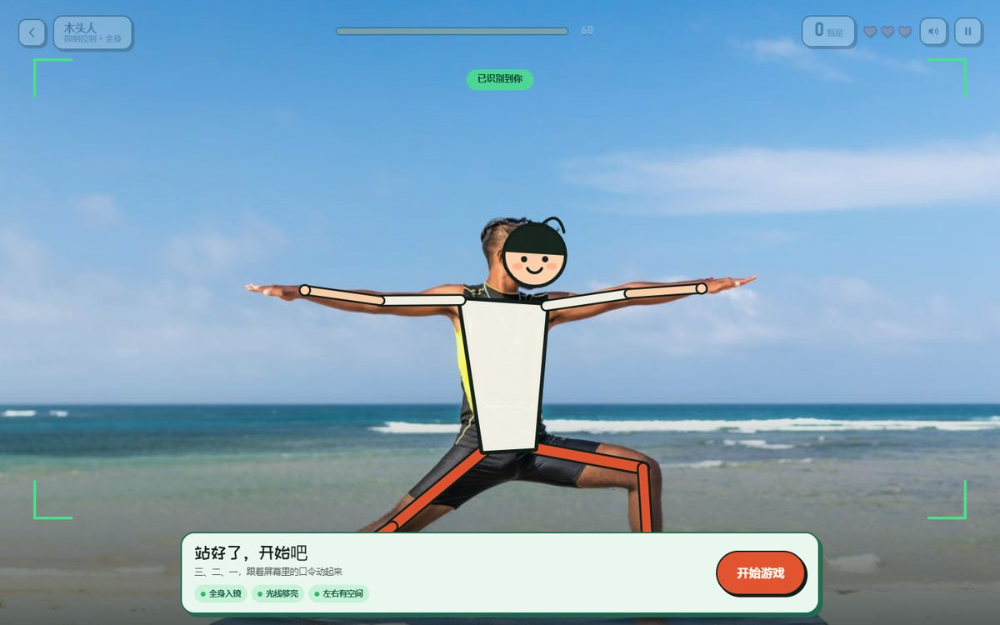

# 动感岛 · 用身体玩的感统小游戏

三个用摄像头玩的儿童体感小游戏，打开网页就能玩：不用手柄，不用下载，画面只在本机识别。


| 游戏 | 练什么 | 怎么玩 |
| --- | --- | --- |
| **木头人** | 抑制控制、听觉指令、全身爆发力 | 绿灯使劲动攒星星，听到「木头人」马上定住，动一下少一颗心 |
| **水果忍者** | 手眼协调、视觉追踪、跨中线 | 挥手臂切飞起来的水果，连击越高分越多，别碰炸弹 |
| **节奏跳跳** | 双侧协调、前庭觉、节奏感 | 踩鼓点向左、向右、原地起跳，光圈收拢时正好到位就是「完美」 |

| 站位 | 游戏里 |
| --- | --- |
|  |  |

## 怎么打开

1. 双击 **`start.bat`**（会启动本地服务器并打开浏览器）。
2. 点「打开摄像头，开始」，允许浏览器使用摄像头。
3. **站到位**：这一屏不弹窗，直接把摄像头画面给你看——地上有一个虚线圈和一个小人虚影，站进去，识别到之后整条状态栏会变绿、右上角显示「已识别到你」，再点「开始游戏」。**只要头和手在画面里就能玩，不用退到房间另一头。**
4. 站在离电脑 **1～2 米** 的地方就够了（笔记本放桌上、屏幕稍微往上翻一点）。

如果不知道往哪边挪，状态栏会直接说：「往前走一点」「往后退一点」「往中间站一点」「光线有点暗」。

如果这台电脑没有摄像头，点「没有摄像头？用鼠标试玩」：移动鼠标＝挥手，`A`/`D`＝左右移动，`空格`＝起跳。

> 为什么不能直接双击 `index.html`：浏览器只允许 `http://` 或 `https://` 页面调用摄像头，`file://` 不行。

换端口：`set PORT=4322 && node server.mjs`

## 页面

- `index.html` —— 首页：三个游戏、感统说明、本周记录
- `play.html?game=freeze|fruit|hop` —— 统一游戏容器
- `check.html` —— 摄像头自检（30 秒，检查头手是否入镜、光线、站位）

## 技术说明

- **姿态识别**：[MediaPipe Pose Landmarker](https://ai.google.dev/edge/mediapipe/solutions/vision/pose_landmarker)（`@mediapipe/tasks-vision`）本地运行，模型和 wasm 都放在 `vendor/`，**完全离线**，不需要联网、不上传任何画面。
- **模型**：默认 `pose_landmarker_lite`（快，够用）；地址加 `?q=full` 换 `pose_landmarker_full`（更准，更吃显卡）。
- **坐标**：摄像头画面按 `cover` 方式铺满画布并水平镜像，关键点用同一套变换映射到屏幕坐标，孩子抬左手，屏幕里的小人也在左边抬左手。
- **运动量**：取手腕、手肘、肩、髋、膝、踝、鼻子的逐帧位移，按「肩宽/秒」归一化后做指数平滑，得到 0～1 的运动量。木头人用它判断「动没动」，跳跃用它判断「离地没离地」。
- **小人渲染**：`js/avatar.js` 把 13 个关键点画成剪纸风角色（先粗描边再填色、圆头、呆毛、腮红），所以任何背景下都能看清轮廓。

## 文件结构

```
index.html / play.html / check.html
css/            base 设计变量、首页、游戏页、自检页、标题字
js/
  pose.js       摄像头 + MediaPipe + 平滑/运动量 + 鼠标小人
  avatar.js     骨骼 → 纸片小人
  kit.js        数学、粒子、音效、程序化音乐、语音
  play.js       游戏运行时（HUD、倒计时、暂停、结算、存档）
  home.js       首页渲染
  check.js      自检页
  games/        freeze.js  fruit.js  hop.js  index.js
vendor/         mediapipe 运行时 + 姿态模型（离线）
assets/fonts/   标题字子集（站酷快乐体，OFL 1.1）
docs/research.md  产品研究与借鉴说明
tools/         开发用截图/姿态自测脚本（非产品代码）
```

## 想再加一个游戏

1. 复制 `js/games/freeze.js` 改个名，实现 `start / update / draw / finish` 四个方法；
2. 在 `js/games/index.js` 里注册；
3. 首页和游戏页会自动出现（`cover` 方法负责封面插画）。

## 已知限制

- 需要 Chrome / Edge 等支持 WebGL 与 `getUserMedia` 的浏览器；Safari 17+ 可用，但性能和兼容性没测过。
- 一局一个人。两人同框时算法只会跟最靠近中间的那个人。
- 逆光、晚上只开一盏顶灯时识别会变差，所以做了自检页和画面提示。
- 平板/手机竖屏能看能玩，但摄像头视野窄，建议横屏或直接用电脑。

## 版权

- 标题字「站酷快乐体 ZCOOL KuaiLe」按 SIL Open Font License 1.1 使用，子集来自 Google Fonts。
- MediaPipe / Pose Landmarker 模型为 Google 的 Apache 2.0 授权。
- 其余代码和插画为本次演示自写。
